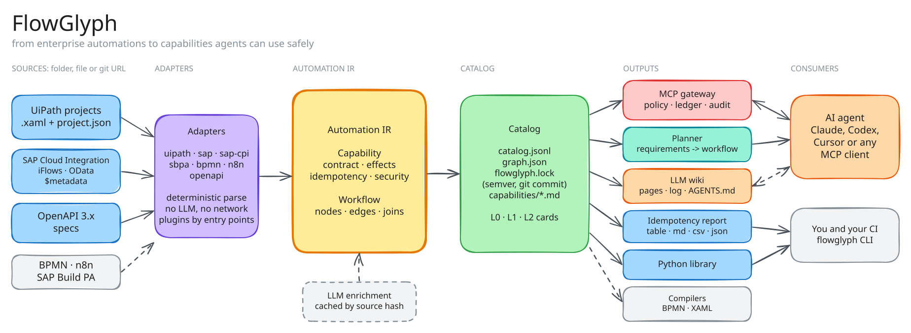
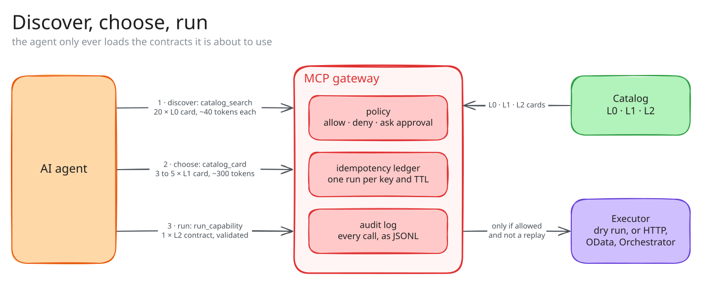

<div align="center">

# FlowGlyph

**Turn enterprise automations into a catalog of functions that people and AI agents can
understand, search and run safely.**

[](https://github.com/afernandeztem/FlowGlyph/actions/workflows/ci.yml)
[](pyproject.toml)
[](LICENSE)
[](pyproject.toml)
[](https://github.com/astral-sh/ruff)
[](CHANGELOG.md)

</div>

<picture>
  <source media="(prefers-color-scheme: dark)" srcset="docs/assets/pipeline-dark.svg">
  
</picture>

## Why

Companies run thousands of automations: UiPath robots, SAP integration flows and OData services,
internal APIs. The
knowledge of what each one does is scattered across XML files, and none of them answers the
two questions that matter before anything, or anyone, presses the button: **what will this
change, and is it safe to run twice?**

FlowGlyph reads those sources with deterministic parsers, never with an LLM, and turns every
workflow, entity operation and API call into a small, typed **capability**: its inputs and
outputs, its effects and its idempotency. From that catalog you take only what you need: a
spreadsheet of functions and their retry safety, a wiki an LLM can maintain, an MCP server that
lets agents use your automations without being able to break the rules, or a planner that
designs new workflows from the capabilities you already have.

## Install

```bash
pip install flowglyph                    # the library: only pydantic and PyYAML
uv tool install "flowglyph[cli]"         # the flowglyph command
pip install "flowglyph[all]"             # everything: CLI, MCP gateway, Anthropic planner
```

| Extra | Adds | For |
|---|---|---|
| none | the Python library | `import flowglyph` in your own tools |
| `cli` | typer, rich | the `flowglyph` command |
| `mcp` | the MCP SDK, jsonschema | `flowglyph serve` |
| `llm` | the Anthropic SDK | `flowglyph plan --via anthropic`; the other planner backends need nothing extra |

## Quickstart

```bash
flowglyph extract https://github.com/UiPath/ReFrameWork -o catalog   # read a whole repository
flowglyph idempotency catalog                                         # every function and its retry safety
flowglyph inspect catalog                                             # the call tree of each entry point
```

```text
Main RWdX none
├── InitiAllSettings RX natural
├── KillAllProcesses pure natural
├── Initialize Applications pure natural
├── GetTransactionData RWX none
├── Process pure natural
├── SetTransactionStatus RWdX none
│   ├── TakeScreenshot RWdX none
│   ├── CloseAllApplications pure natural
│   └── KillAllProcesses pure natural
└── CloseAllApplications pure natural
```

`R` reads, `W` writes, `D` destroys, `X` talks to another system; upper case means yes, lower
case means it may. `natural` means safe to retry; `none` means a retry repeats the effect.

## Pick what you need

Every piece works on its own. Start with the first row and stop wherever you have what you need.

| I want to... | Run | Get |
|---|---|---|
| Know what every function does and whether it can be retried | `flowglyph idempotency <source>` | a table, or Markdown, CSV, JSON |
| Keep a versioned catalog of all functions | `flowglyph extract <source> -o catalog` | `catalog.jsonl`, `graph.json`, `flowglyph.lock`, one card per function |
| Give people and LLMs a wiki of the automations | `flowglyph wiki build <source> -o wiki` | linked pages, an index, a log and an `AGENTS.md` for the LLM |
| Let an AI agent use the automations safely | `flowglyph serve catalog` | an MCP server with policy, idempotency and audit |
| Design a new workflow from a description | `flowglyph plan requirements.md catalog` | a checked workflow, with the missing pieces named |
| Fail CI when a contract breaks | `flowglyph diff old.lock catalog --fail-on major` | a non-zero exit on breaking changes |
| Build my own tooling | `import flowglyph` | the same features as a typed Python API |

`<source>` is a folder, a single file or a git URL. A saved catalog folder works too, anywhere a
source is accepted.

## Sources

### Where FlowGlyph reads from

```bash
flowglyph extract ./automations                                   # a folder: every project inside
flowglyph extract ./services/ZSUPPLIER_INVOICE_SRV.edmx           # a single file
flowglyph extract https://github.com/acme/rpa                     # a repository
flowglyph extract https://github.com/acme/rpa/tree/main/finance   # a folder of a repository, as copied from the browser
flowglyph extract git@github.com:acme/rpa.git --ref release-4.2   # a branch, tag or commit
```

A folder is walked completely. A repository holding forty UiPath projects, a few SAP service
definitions and some OpenAPI specs becomes **one** catalog: each project keeps its own name in
the capability ids, and nested projects are read once. Repositories are shallow-cloned into
`~/.cache/flowglyph` (or `$FLOWGLYPH_CACHE`) and refreshed on the next run; the lock file records
the URL and the exact commit, so every catalog can be traced back to what it was built from.

### What FlowGlyph understands

```bash
flowglyph adapters
```

| Adapter | Reads | Each capability is |
|---|---|---|
| `uipath` | UiPath Studio projects: `project.json` and every `.xaml` | a workflow, typed from its arguments, with its graph of steps; plus one entry per activity type in use |
| `sap` | SAP OData `$metadata` documents (EDMX, OData V2 and V4) from SAP S/4HANA, SAP Gateway or SAP BTP | an entity operation (query, read, create, update, delete), a function import, a function or an action |
| `sap-cpi` | SAP Cloud Integration (SAP Integration Suite) iFlows, exported as `.zip` or unpacked | an endpoint the iFlow exposes (HTTPS, SOAP, OData, IDoc, ProcessDirect...), with the iFlow's steps as its graph |
| `openapi` | OpenAPI 3.0 and 3.1 documents, JSON or YAML | an API operation |

By default every adapter is tried and everything found is extracted. Pick one with `--adapter`:

```bash
flowglyph extract ./landscape --adapter sap      # only the SAP OData services
flowglyph extract ./landscape --adapter sap-cpi  # only the SAP Cloud Integration iFlows
flowglyph idempotency ./landscape -a uipath      # only the robots
```

For SAP Cloud Integration, export the integration flows from the Integration Suite design
workspace (or keep them unpacked in git, as most teams do) and point FlowGlyph at the folder.
Besides the catalog, the adapter reviews each iFlow's design and keeps the findings on its
capability, where `wiki lint` shows them: a main process without an exception subprocess,
receivers over plain HTTP or without a timeout, hard-coded addresses, routers without a default
route, splitters that do not stream, the whole body copied into a property, CSRF protection
turned off. Values in `parameters.prop` are never read, only the names of the parameters.

To get the metadata of an SAP service, open
`https://<host>/sap/opu/odata/sap/<SERVICE_NAME>/$metadata` (OData V2) or the `$metadata` of the
V4 service and save it, or download it from the SAP Business Accelerator Hub. Files named
`$metadata`, `*.edmx` or `*.xml` are recognised by their content.

### How effects and idempotency are decided

Nothing is guessed by a model. Each adapter applies the semantics of its platform, and every
answer records whether it was inferred, or declared by the source itself or by a person.

| Source | Rule |
|---|---|
| UiPath | Each activity is classified by an [editable taxonomy](src/flowglyph/adapters/uipath/taxonomy.yaml) (Excel, mail, Orchestrator, UI, file system...). A workflow has the effects of its activities and of every workflow it invokes. UI automation is never assumed harmless. |
| SAP Cloud Integration | Receivers decide the effects: an HTTP `GET` reads, `POST` writes, `DELETE` destroys; mail, SFTP, IDoc and SOAP receivers send; Data Store writes change tenant state. ProcessDirect calls between iFlows become calls in the graph, so an iFlow inherits the effects of the iFlows it hands over to. Idempotency the iFlow declares itself (an idempotent process call, an exactly-once adapter) is taken as declared; a Data Store write without overwrite makes it conditional. |
| SAP OData | Query and read are read-only and idempotent. Update and delete are idempotent; delete is destructive. Create and actions are not idempotent. Operations the service forbids (`sap:creatable="false"`, V4 `InsertRestrictions`...) are not generated at all. |
| OpenAPI | HTTP semantics (RFC 9110): `GET` reads, `PUT` and `DELETE` are idempotent, `POST` is retry-safe only when the operation accepts an `Idempotency-Key` header. |

## Recipes

Three complete walkthroughs, with real output, live in `examples/`:

- [A UiPath process on the ReFrameWork](examples/uipath-reframework): UiPath's own template
  through the call tree, the idempotency report, overrides, a change made in Studio, the wiki
  and the gateway.
- [An SAP landscape](examples/sap-integration): OData services and Cloud Integration iFlows
  through the report, overrides, the wiki and the gateway.
- [Supplier invoice intake](examples/invoice-processing): a UiPath project and an OpenAPI
  document in one catalog, planned and served.

### 1. Only the functions and their idempotency

```bash
flowglyph idempotency https://github.com/acme/rpa                # table in the terminal
flowglyph idempotency ./rpa -f csv -o functions.csv              # for a spreadsheet
flowglyph idempotency ./rpa -f markdown -o FUNCTIONS.md          # for a pull request
flowglyph idempotency ./rpa --side-effects --kind workflow       # only workflows that change something
flowglyph idempotency ./rpa --review                             # only what still needs a decision
```

Each row gets a status:

| Status | Meaning |
|---|---|
| `safe` | no side effects, or naturally idempotent |
| `keyed` | retry-safe when called with its idempotency key |
| `declared` | a person declared how it behaves |
| `review` | it changes something and nothing guarantees a retry is safe |

### 2. Iterate until nothing is left to review

The parser tells you what it can prove. The rest you decide, in a file next to the sources, and
the decision becomes part of the catalog.

```bash
flowglyph idempotency ./rpa --review
```

```yaml
# ./rpa/flowglyph.overrides.yaml
capabilities:
  uipath/Invoices/Main:
    description: Books a supplier invoice in the ERP.
    idempotency: {mode: key, key_fields: [in_InvoiceReference], ttl_seconds: 86400}
    security: {approval_required: true}
  sap/ZSUPPLIER_INVOICE_SRV/SupplierInvoice/create:
    idempotency: {mode: key, key_fields: [body]}
```

```bash
flowglyph idempotency ./rpa --review      # the declared ones are gone from the list
flowglyph extract ./rpa -o catalog        # and the catalog records them as declared
```

Run it as often as you like. Unchanged sources produce byte-identical output, and changed ones
get the right semver bump: `major` when an input becomes required or disappears, `minor` when one
is added or the behaviour changes, `patch` for documentation.

### 3. An LLM wiki of the automations

```bash
flowglyph wiki build https://github.com/acme/rpa -o wiki
flowglyph wiki lint wiki
```

This follows Andrej Karpathy's [LLM Wiki](https://gist.github.com/karpathy/442a6bf555914893e9891c11519de94f)
pattern. The automation sources are the raw layer and are never touched. FlowGlyph writes the
structural part of every page; an LLM, or you, adds what the sources cannot say.

```text
wiki/
├── AGENTS.md        the schema: how an LLM should maintain this wiki; yours to edit, never overwritten
├── index.md         every page by category, one line each
├── overview.md      sources, counts, what is left to review, invocations that point nowhere
├── log.md           append-only: "## [2026-11-04] ingest | ..." and "## [2026-11-04] lint | ..."
├── capabilities/    one page per function: contract, effects, steps, used by, related
├── categories/      one page per category
├── sources/         one page per project or service, with call trees
└── _data/           the machine-readable catalog
```

Every page ends with a **Notes** section, and everything written there, by a person or by an
LLM, survives each rebuild. When a function leaves the sources its page is deleted, unless it
has notes: then it is kept and marked as removed. `wiki lint` lists functions to review,
invocations outside the sources, workflows nothing calls, broken links and retired pages.

To work on it with an LLM, open the wiki folder in Claude Code, Codex, Cursor or any assistant
and ask it to follow `AGENTS.md`: ingest after each `wiki build`, answer questions from the pages
and work through `wiki lint`.

### 4. Let an AI agent use the automations

```bash
pip install "flowglyph[mcp]"
flowglyph serve catalog --policy policy.yaml
claude mcp add flowglyph -- flowglyph serve /path/to/catalog    # Claude Code; any MCP client works
```

The agent never runs anything directly. It goes through the gateway, which on every call:

1. validates the arguments against the capability's JSON Schema;
2. applies your policy: allow, deny, or hold for a person's approval;
3. runs anything with side effects at most once per idempotency key, and gives a retry the stored
   result;
4. executes it: as a dry run that shows exactly what would be sent, or for real through the
   systems named in a connections file;
5. records the call in an audit log, without the argument values.

<picture>
  <source media="(prefers-color-scheme: dark)" srcset="docs/assets/token-flow-dark.svg">
  
</picture>

| MCP tool | What the agent gets |
|---|---|
| `catalog_search` | L0 cards, about 40 tokens each, to scan thousands of functions |
| `catalog_card` | the L1 card of one function: inputs, outputs, steps, retry advice |
| `catalog_contract` | the full L2 contract |
| `run_capability`, or one tool per function | a run through the gateway |
| `run_status` | the outcome of an earlier run |

To run for real, describe each system once in `flowglyph.connections.yaml` and serve with
`--connections`. The file names the environment variables that hold credentials; it never holds
them. Capabilities no connection claims are refused, not dry-run.

```yaml
# flowglyph.connections.yaml
connections:
  erp:
    type: odata
    service_url: https://erp.example.com/sap/opu/odata/sap/ZSUPPLIER_INVOICE_SRV
    auth: {type: basic, user_env: SAP_USER, password_env: SAP_PASSWORD}
    capabilities: ["sap/ZSUPPLIER_INVOICE_SRV/*"]
  robots:
    type: uipath
    url: https://cloud.uipath.com/acme/finance/orchestrator_
    folder: Finance/Invoices
    auth: {type: client_credentials, token_url: https://cloud.uipath.com/identity_/connect/token,
           client_id_env: UIPATH_CLIENT_ID, client_secret_env: UIPATH_CLIENT_SECRET,
           scope: OR.Folders.Read OR.Execution OR.Jobs}
    capabilities: ["uipath/*"]
  payments:
    type: http
    base_url: https://api.example.com/v1
    auth: {type: bearer, token_env: PAYMENTS_TOKEN}
    capabilities: ["openapi/Payments_API/*"]
```

```bash
flowglyph serve catalog --policy policy.yaml --connections flowglyph.connections.yaml
```

| Connection | Runs | How |
|---|---|---|
| `http` | OpenAPI operations | each argument goes where the document puts it: path, query, header, cookie or body |
| `odata` | SAP OData V2 and V4 operations | CSRF token fetched and refreshed as SAP requires, keys and parameters written as OData literals, `MERGE` for V2 updates, SAP error messages quoted |
| `uipath` | the entry point of a UiPath project, as a published process | starts a job in the folder, passes the inputs as job arguments, waits for it and returns its output arguments |

```yaml
# policy.yaml
default: allow
rules:
  - {capabilities: "sap/*/*/delete", action: deny, reason: deletions go through change management}
  - {capabilities: "openapi/*/executePayment", action: deny, reason: payments are released by treasury}
  - {if_effects: [destructive], action: require_approval, reason: may destroy data}
```

```bash
flowglyph approvals catalog                     # what is waiting for a person
flowglyph approve catalog '<idempotency key>'   # let the agent's next attempt run it
```

### 5. Design a workflow from a description

```bash
flowglyph plan requirements.md catalog -o plan --via claude-code
```

Describe what you need in plain language. A model proposes a plan using only the capabilities in
the catalog; a deterministic resolver then checks every capability, argument, reference and
dependency. A step that nothing in the catalog can do is reported as **missing** instead of being
invented, so the plan doubles as a gap analysis. See
[examples/invoice-processing](examples/invoice-processing).

The planner works with whatever you already use:

| `--via` | Uses | Needs |
|---|---|---|
| `anthropic` (default) | the Anthropic API | `pip install "flowglyph[llm]"` and an API key |
| `claude-code`, `codex`, `gemini`, `cursor` | that coding assistant, run headless with your account | the CLI installed and signed in; your subscription covers it |
| `openai-compatible` | OpenAI, Ollama, vLLM, LM Studio, OpenRouter, LiteLLM | `--model`, plus `OPENAI_BASE_URL` / `OPENAI_API_KEY` when needed |
| a plugin | any SDK | a package registering a `flowglyph.planners` entry point |

```bash
OPENAI_BASE_URL=http://localhost:11434/v1 flowglyph plan requirements.md catalog \
  --via openai-compatible --model llama3.1
```

### 6. Use it from Python

```python
import flowglyph
from flowglyph import report, wiki

catalog = flowglyph.extract("https://github.com/acme/rpa", adapter="uipath")

for row in report.rows(catalog, side_effects_only=True, statuses=["review"]):
    print(row.id, row.effects, row.advice)

invoice = catalog.get("Steps/BookInvoice")
print([p.name for p in invoice.inputs], effects_code(invoice.effects), invoice.idempotency.mode)

workflow = catalog.workflow("Main")
print(workflow.simulate(lambda condition: False))  # which steps run when every condition is false

catalog.save("catalog")
wiki.build_wiki(catalog, "wiki")
```

```python
from flowglyph.gateway import Gateway, Policy

gateway = Gateway("catalog", policy=Policy.load("policy.yaml"))
result = gateway.run("createInvoice", {"Idempotency-Key": "inv-118", "body": invoice_body})
print(result.status)  # done, replayed, approval_required, denied, invalid...
```

## How it works

**The Automation IR** is the contract between everything else. A `Capability` says what an
operation needs, what it returns, what it does to the world (`reads`, `mutates_state`,
`destructive`, `external`, each `yes`, `no` or `unknown`) and how it can be retried (`natural`,
`key`, `conditional`, `none`). A `Workflow` is the graph behind it: steps, conditional edges, and
a `join` on each step that says whether it needs every predecessor to have run or just one. The
full specification is in [docs/ir-spec.md](docs/ir-spec.md).

```yaml
id: sap/ZSUPPLIER_INVOICE_SRV/SupplierInvoice/create
kind: operation
effects: {reads: no, mutates_state: yes, destructive: no, external: yes}
idempotency: {mode: none, provenance: inferred, confidence: 0.7}
input_schema:
  properties:
    body:
      properties:
        CompanyCode: {type: string, maxLength: 4, description: Company code}
        InvoicingParty: {type: string, maxLength: 10, description: Supplier}
      required: [CompanyCode, InvoicingParty]
```

**Adapters** produce IR and nothing else. They are deterministic and offline, so the same files
always give the same catalog. New source formats are plugins: implement
`flowglyph.adapters.Adapter` and register it under the `flowglyph.adapters` entry point group.

**The catalog** is plain files you can commit and review. Agents read it at three levels of
detail (L0 to search, L1 to choose, L2 to call), so they never load more contracts than they use.

**The gateway** is the only part that executes, and the only part that has to be trusted:
annotations and idempotency modes describe intent, the gateway enforces it.

More in [docs/architecture.md](docs/architecture.md) (bounded contexts and the rules between
them), [docs/glossary.md](docs/glossary.md) (every term FlowGlyph uses) and the
[decision records](docs/adr/README.md).

## Command reference

| Command | Purpose | Key options |
|---|---|---|
| `flowglyph extract SOURCE` | build a catalog | `-o`, `--adapter`, `--ref`, `--strict` |
| `flowglyph idempotency SOURCE` | the function list and its retry safety | `-f table/markdown/csv/json`, `-o`, `--kind`, `--provider`, `--side-effects`, `--review`, `--adapter` |
| `flowglyph inspect SOURCE [CAPABILITY]` | call trees, or one function's card | |
| `flowglyph search SOURCE QUERY` | find functions by what they do | `-n`, `--invocable` |
| `flowglyph validate CATALOG` | schema and reference checks | |
| `flowglyph diff OLD NEW` | what changed between two extractions | `--fail-on major/minor/patch` |
| `flowglyph adapters` | the source formats available | |
| `flowglyph wiki build SOURCE` | write or refresh the LLM wiki | `-o`, `--adapter`, `--ref` |
| `flowglyph wiki lint [WIKI]` | check the wiki | `--strict` |
| `flowglyph serve CATALOG` | the MCP gateway | `--policy`, `--state`, `--expose auto/all/meta` |
| `flowglyph approvals CATALOG` | runs waiting for a person | |
| `flowglyph approve CATALOG KEY` | approve one of them | |
| `flowglyph plan REQUIREMENTS SOURCE` | design a workflow | `--via`, `--model`, `--effort`, `-o` |

Every command has `--help`.

## How FlowGlyph compares

| | FlowGlyph | UiPath and SAP native MCP servers | XAML parsers such as `xaml-parser` | Generic OpenAPI to MCP converters |
|---|---|---|---|---|
| Sources | UiPath, SAP Cloud Integration, SAP OData, OpenAPI, pluggable | their own platform | UiPath | OpenAPI |
| Vendor-neutral model | yes, the Automation IR | no | no | no |
| Effects and retry safety | tri-state effects, idempotency with provenance, enforced by a gateway | hints | no | hints from HTTP verbs at best |
| Contract versioning | semver from a lock file, with the git commit | platform versions | no | no |
| Knowledge base for LLMs | generated wiki with preserved notes | no | no | no |
| Runs locally, offline | yes | no, cloud platform | yes | yes |
| License | Apache-2.0 | proprietary | CC BY 4.0 | varies |

## Roadmap

- [x] Automation IR with joins, versioned catalog, CLI
- [x] Adapters for UiPath, SAP Cloud Integration, SAP OData and OpenAPI; extraction from folders and git repositories
- [x] Idempotency report and LLM wiki
- [x] MCP gateway with policy, idempotency ledger and audit log (dry-run execution)
- [x] Planner with any model provider or coding assistant
- [x] Executors that run against UiPath Orchestrator, SAP OData and HTTP APIs
- [ ] LLM enrichment cached by source hash; more adapters (BPMN, SAP Build Process Automation, n8n)
- [ ] Compilers from workflow IR back to BPMN and XAML

## Contributing

Contributions are welcome. [CONTRIBUTING.md](CONTRIBUTING.md) explains the setup (`make install`,
`make check`), the code style, and how to write an adapter, with a complete example. Diagrams are
edited in [Excalidraw](https://excalidraw.com) from the `.excalidraw` files in `docs/assets/` and
rendered with `make diagrams`. Security issues: see [SECURITY.md](SECURITY.md).

## License

[Apache License 2.0](LICENSE). Test fixtures from UiPath ReFrameWork are MIT-licensed, see
[NOTICE](NOTICE).

UiPath and SAP are trademarks of their respective owners. FlowGlyph is an independent project
and is not affiliated with or endorsed by them.
