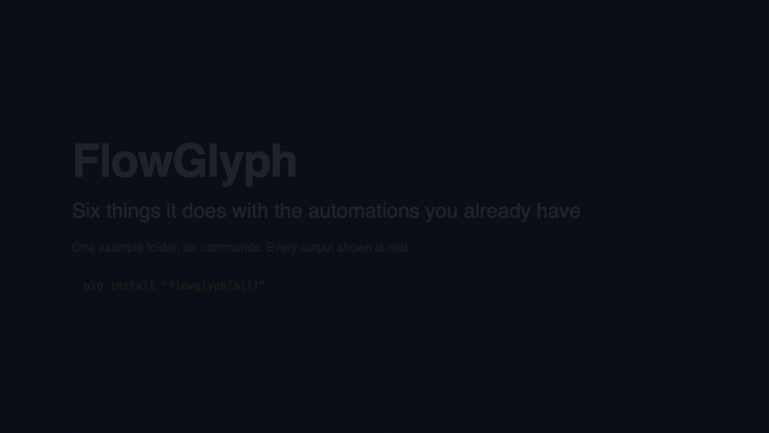

<div align="center">

# FlowGlyph

**Turn enterprise automations into a catalog of functions that people and AI agents can
understand, search and run safely.**

[](https://github.com/afernandeztem/FlowGlyph/actions/workflows/ci.yml)
[](pyproject.toml)
[](LICENSE)
[](pyproject.toml)
[](https://github.com/astral-sh/ruff)
[](CHANGELOG.md)

</div>

<picture>
  <source media="(prefers-color-scheme: dark)" srcset="docs/assets/pipeline-dark.svg">
  
</picture>

## Why

Before anything, or anyone, presses the button on an automation, two questions matter: **what
will this change, and is it safe to run twice?** Companies run thousands of automations, UiPath
robots, SAP integration flows and OData services, SAP Build processes, BPMN processes, n8n
workflows, internal APIs, and the answers are scattered across XML and JSON files nobody reads.

FlowGlyph reads those files with deterministic parsers, never with a model, and turns every
workflow, service operation and API call into a small, typed **capability**: its inputs and
outputs, what it does to the world, and whether a retry is a repeat. Every answer says whether
it was inferred or declared, and what the sources cannot settle, you declare once in a file
next to them. From that catalog you take only what you need: a report of every function and
its retry safety, a wiki an LLM can maintain, an MCP gateway that lets agents use the
automations without being able to break the rules, a planner that designs new workflows from
the capabilities you already have, or context files for the coding agent working on a project.

**New here?** The [guide](docs/guide.md) walks through every feature in order, with samples
you can run from a clone. [HOWTO.md](HOWTO.md) is the reference: every tool, what it does and
how to use it.

## Install

```bash
pip install flowglyph                    # the library: only pydantic and PyYAML
uv tool install "flowglyph[cli]"         # the command line
pip install "flowglyph[all]"             # everything: CLI, MCP gateway, Anthropic planner
```

| Extra | Adds | For |
|---|---|---|
| none | the Python library | `import flowglyph` in your own tools |
| `cli` | typer, rich | the `flowglyph` command |
| `mcp` | the MCP SDK, jsonschema | `flowglyph serve`, and `flowglyph.gateway` from Python |
| `llm` | the Anthropic SDK | `flowglyph plan --via anthropic`; the other planner backends need nothing extra |
| `documents` | pypdf, python-docx, openpyxl | `flowglyph plan` from a PDF, Word or Excel document |

From a clone, before there is a release on PyPI:

```bash
git clone https://github.com/afernandeztem/FlowGlyph && cd FlowGlyph
uv sync --all-extras && uv run flowglyph --version      # or: pip install -e ".[all]"
```

## Quickstart

```bash
flowglyph extract https://github.com/UiPath/ReFrameWork -o catalog   # read a whole repository
flowglyph idempotency catalog                                         # every function and its retry safety
flowglyph inspect catalog                                             # the call tree of each entry point
```

```text
Main RWdX none
├── InitiAllSettings RX natural
├── KillAllProcesses pure natural
├── Initialize Applications pure natural
├── GetTransactionData RWX none
├── Process pure natural
├── SetTransactionStatus RWdX none
│   ├── TakeScreenshot RWdX none
│   ├── CloseAllApplications pure natural
│   └── KillAllProcesses pure natural
└── CloseAllApplications pure natural
```

`R` reads, `W` writes, `D` destroys, `X` talks to another system; upper case means yes, lower
case means it may, `pure` means none of them. `natural` means a repeat changes nothing more;
`none` means every run has an effect.

Look at `GetTransactionData`: it **writes**. Its *Get Transaction Item* activity marks the queue
item *In Progress*, so calling it twice takes two different items. A retry is not a repeat. That
is the kind of fact FlowGlyph puts in front of you, from the sources alone, before an agent
retries something it should not.

## Pick what you need

Every piece works on its own. Start with the first row and stop wherever you have what you need.

| I want to... | Run | Get |
|---|---|---|
| Know what every function does and whether it can be retried | `flowglyph idempotency <source>` | a table, or Markdown, CSV, JSON |
| Keep a versioned catalog of all functions | `flowglyph extract <source> -o catalog` | `catalog.jsonl`, `graph.json`, `flowglyph.lock`, one card per function |
| Fail CI when a contract breaks | `flowglyph diff old-catalog catalog --fail-on major` | a non-zero exit on breaking changes |
| Give people and LLMs a wiki of the automations | `flowglyph wiki build <source> -o wiki` | linked pages, an index, a log and an `AGENTS.md` for the LLM |
| Describe what sources leave undescribed | `flowglyph enrich catalog --via claude-code` | descriptions and business meaning, marked as generated, cached |
| Let an AI agent use the automations safely | `flowglyph serve catalog --policy policy.yaml` | an MCP server with policy, idempotency and audit |
| Design a new workflow from a description | `flowglyph plan requirements.md catalog` | a checked workflow, with the missing pieces named |
| Turn a workflow into BPMN or UiPath | `flowglyph compile plan/workflow.ir.yaml --to bpmn` | a `.bpmn` or `.xaml` its tool opens |
| Give coding agents context on a UiPath project | `flowglyph context ./robots` | `AGENTS.md`, project context and activity cards, from the sources |
| Build my own tooling | `import flowglyph` | the same features as a typed Python API |

`<source>` is a folder, a single file, a git URL (a repository, a folder of it, or `--ref` a
branch, tag or commit) or a catalog saved earlier. Each row is one section of
[HOWTO.md](HOWTO.md).

## Six things, on one folder

Each row of the table above is a tool of its own. To show how they connect, here are six of
them on one folder, the kind a client hands over: a UiPath project, the OpenAPI document of
the payments API and the process definition in Word. Every output is real; the sources are in
`tests/fixtures`, the process document is a two-page Word file with a table of steps. Each step
is also a page of its own in [docs/use-cases](docs/use-cases/README.md), with who it is for
and how to tell it.



*Eighty-five seconds, also as a [video](docs/assets/walkthrough.mp4); rendered from the real output
by `make walkthrough`.*

**1. Read everything that exists.** One command, every format it finds.

```bash
flowglyph extract ./handover -o catalog
```

```text
Extracted 11 invocable capabilities and 7 that cannot be run on their own into catalog
  warning payments-api.yaml: PATCH /invoices/{invoiceId} has no operationId, using patch_invoices_invoiceId
  warning Invoices/Main.xaml: invoked workflow not found in the project: Steps/Missing.xaml
```

**2. Settle what the sources cannot say.** The report lists what still needs a decision. You
write the decision once, next to the sources, and it becomes part of the catalog.

```bash
flowglyph idempotency ./handover --review
```

```text
 Capability                                     Kind       Effects  Idempotency  Status
 openapi/Payments_API/executePayment            operation  rWX      none         review
 openapi/Payments_API/patch_invoices_invoiceId  operation  rWdX     none         review
 uipath/Invoices/Main                           workflow   WX       none         review
 uipath/Invoices/Steps/BookInvoice              workflow   WX       none         review
 uipath/Invoices/Steps/RequestApproval          workflow   WX       none         review
5 capabilities, 5 to review.
```

```yaml
# handover/flowglyph.overrides.yaml
capabilities:
  uipath/Invoices/Steps/BookInvoice:
    idempotency: {mode: key, key_fields: [in_Invoice]}
  uipath/Invoices/Steps/RequestApproval:
    description: Emails the finance approver; a second email is harmless.
    idempotency: {mode: natural}
  openapi/Payments_API/executePayment:
    security: {approval_required: true}
```

Run the report again: three rows are left, and `BookInvoice` and `RequestApproval` read
`declared`.

**3. Give the agents the picture.** A wiki for people and LLMs, and the files a coding agent
reads before touching the project, both from the sources alone.

```bash
flowglyph wiki build ./handover -o wiki
flowglyph context ./handover --catalog catalog
```

```text
Wiki 30 pages in wiki
Context Invoices: 9 files written, 0 unchanged, in handover/Invoices
```

`handover/Invoices/AGENTS.md` now states that `Main.xaml` takes `in_Threshold: number`, that
`BookInvoice` writes to an Orchestrator queue and must not be retried blindly, and
`.flowglyph/activities/AddQueueItem.md` holds the XAML this project uses for that activity.

**4. Design the new workflow from the client's own document.** A model proposes the steps
from the Word file; FlowGlyph checks each one against the catalog.

```bash
flowglyph plan ./handover/supplier-invoice-pdd.docx catalog -o plan --via claude-code
```

```text
Book emailed supplier invoices without creating duplicates, then archive the PDF
 Step               Capability                             Intent
 validate_vendor    uipath/Invoices/Steps/ValidateVendor   Check that the vendor on the invoice exists in our records.
 notify_purchasing  missing                                Notify purchasing that the vendor is unknown and stop processing the invoice.
 request_approval   uipath/Invoices/Steps/RequestApproval  Ask the finance approver for approval before booking a high-value invoice.
 create_invoice     openapi/Payments_API/createInvoice     Create the invoice in the payments system, keyed by the invoice reference so a retry never books it twice.
 archive_pdf        missing                                Archive the invoice PDF in the document store with a 10-year retention period.
```

Two steps are **missing**, and that is the point: nothing in the sources notifies purchasing or
archives a PDF, so the plan doubles as the gap list, and nothing was invented to fill it.

**5. Open it in Studio.**

```bash
flowglyph compile plan/workflow.ir.yaml --catalog catalog --to xaml -o Main.xaml
```

```text
  warning conditions are copied as written; rewrite them as Visual Basic expressions in Studio
Compiled plan/book-emailed-supplier-invoices-without-creating-duplicates-then-archive-the-pdf into Main.xaml
```

A Flowchart with the three resolved steps as `InvokeWorkflowFile` calls, their arguments ready
to bind, and a `Comment` placeholder where each missing step goes. Those two are what the coding agent
builds next, from the activity cards; `flowglyph skill` tells it how.

**6. Or let an agent run what exists, safely.**

```bash
flowglyph serve catalog --policy policy.yaml
```

Every call goes through the contract, your policy, the idempotency ledger and the audit log,
and `executePayment` waits for a person.

## What it reads

| Adapter | Reads | Each capability is |
|---|---|---|
| `uipath` | UiPath Studio projects: `project.json` and every `.xaml` | a workflow typed from its arguments, with its graph of steps |
| `sap` | SAP OData `$metadata`, V2 and V4 | an entity operation, function import, function or action the service allows |
| `sap-cpi` | SAP Cloud Integration iFlows, `.zip` or unpacked | an endpoint the iFlow exposes, with its steps as the graph |
| `sbpa` | SAP Build Process Automation projects, `.mtar` or unpacked | a process, and the automations and decisions it runs |
| `bpmn` | BPMN 2.0, with Camunda 7 and Camunda 8 extensions | a process, with tasks, gateways and call activities |
| `n8n` | n8n workflow exports | a workflow, started by its webhook, form, schedule or a parent |
| `openapi` | OpenAPI 3.0 and 3.1 documents | an API operation |

Nothing is guessed by a model: each adapter applies the semantics of its platform, an editable
taxonomy for UiPath activities, HTTP and OData semantics for services, the receiver types of an
iFlow. [HOWTO.md](HOWTO.md#adapters) lists the rules. New formats are plugins: implement
`flowglyph.adapters.Adapter` and register it under the `flowglyph.adapters` entry point group.

## Examples

Three complete walkthroughs, with the real output of every command:

- [A UiPath process on the ReFrameWork](examples/uipath-reframework): UiPath's own template
  through the call tree, the report, overrides, a change made in Studio, the wiki and the
  gateway.
- [An SAP landscape](examples/sap-integration): OData services and Cloud Integration iFlows
  through the report, overrides, the wiki and the gateway.
- [Supplier invoice intake](examples/invoice-processing): a UiPath project and an OpenAPI
  document in one catalog, planned and served.

## How it works

**The Automation IR** is the contract between everything else. A `Capability` says what an
operation needs, what it returns, what it does to the world (`reads`, `mutates_state`,
`destructive`, `external`, each `yes`, `no` or `unknown`) and how it can be retried (`natural`,
`key`, `conditional`, `none`). A `Workflow` is the graph behind it: steps, guarded edges, and a
`join` on each step that says whether it needs every predecessor to have run or just one. The
full specification is in [docs/ir-spec.md](docs/ir-spec.md).

```yaml
id: sap/ZSUPPLIER_INVOICE_SRV/SupplierInvoice/create
kind: operation
effects: {reads: no, mutates_state: yes, destructive: no, external: yes}
idempotency: {mode: none, provenance: inferred, confidence: 0.7}
input_schema:
  properties:
    body:
      properties:
        CompanyCode: {type: string, maxLength: 4, description: Company code}
        InvoicingParty: {type: string, maxLength: 10, description: Supplier}
      required: [CompanyCode, InvoicingParty]
```

**Adapters** produce IR and nothing else. They are deterministic and offline, so the same files
always give the same catalog, byte for byte.

**The catalog** is plain files you can commit and review, versioned by a lock file: a change
that can break a caller is a major version. Agents read it at three sizes, a one-line card to
search thousands of functions, a page to choose between a few, the full contract to call one,
so they never load more than they use.

**The gateway** is the only part that executes, and the only part that has to be trusted:
effects and idempotency modes describe intent, the gateway enforces it. Every call is validated
against the contract, checked against your policy, run at most once per idempotency key, and
written to an audit log.

More in [docs/architecture.md](docs/architecture.md) (the parts and the rules between them),
[docs/glossary.md](docs/glossary.md) (every term FlowGlyph uses) and the
[decision records](docs/adr/README.md).

## Status

Alpha. The IR is at version 0.4 and may still change before 1.0, as may the library API; the
command line and the file formats are what the guide and the reference describe. What makes
FlowGlyph different from the tooling each vendor ships: one model for every platform, effects and
retry safety as facts with a provenance rather than hints, a gateway you host that enforces
them, and nothing that leaves your machine.

## Contributing

Contributions are welcome. [CONTRIBUTING.md](CONTRIBUTING.md) explains the setup (`make install`,
`make check`), the code style, and how to write an adapter, with a complete example. Diagrams are
edited in [Excalidraw](https://excalidraw.com) from the `.excalidraw` files in `docs/assets/` and
rendered with `make diagrams`. Security issues: see [SECURITY.md](SECURITY.md).

## License

[Apache License 2.0](LICENSE). Test fixtures from UiPath ReFrameWork are MIT-licensed, see
[NOTICE](NOTICE).

UiPath and SAP are trademarks of their respective owners. FlowGlyph is an independent project
and is not affiliated with or endorsed by them.
