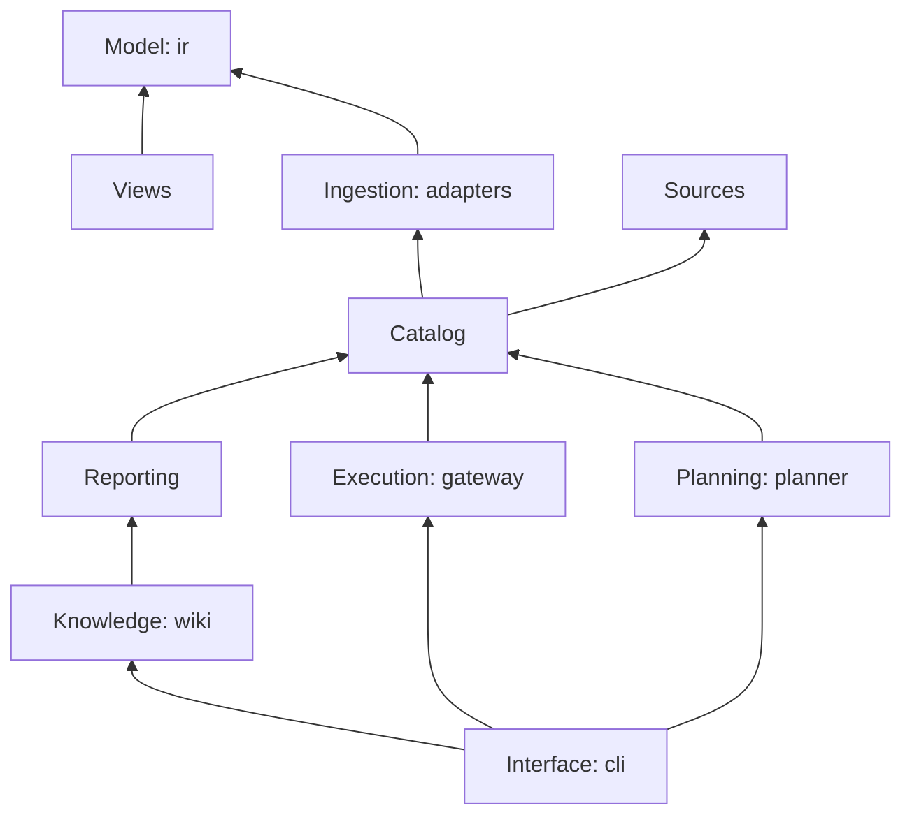

# Architecture

FlowGlyph reads automations written for one vendor and describes them in a model that belongs to
none: the Automation IR. Everything else is built on that model. This page explains how the code
is divided, which part may depend on which, and where to start when you want to change
something. The words in *italics* are defined in the [glossary](glossary.md).

## The pipeline

```
          sources                    ingestion                    catalog
 ┌──────────────────────┐   ┌───────────────────────┐   ┌───────────────────────┐
 │ folder, file, git URL│──►│ adapters: UiPath, SAP │──►│ versioned, searchable │
 └──────────────────────┘   │ OData, SAP CPI,       │   │ capabilities and      │
                            │ OpenAPI, plugins      │   │ workflows + lock file │
                            └───────────────────────┘   └───────────┬───────────┘
                                                                    │
                ┌───────────────────┬───────────────────┬───────────┴───────┬──────────────┐
                ▼                   ▼                   ▼                   ▼              ▼
         idempotency report     LLM wiki        MCP gateway (policy,     planner      your code
                                                ledger, audit)                     (import flowglyph)
```

Each stage only reads what the stage before it produced, so every stage can be used, tested and
replaced on its own. `flowglyph extract` stops after the catalog; `flowglyph idempotency` is the
catalog and one table; the gateway and the planner never look at a source file.

## Bounded contexts

The code is divided into contexts that each own one part of the language. A context may use the
contexts below it in this table, never those above.

| Context | Package | Owns | Depends on |
|---|---|---|---|
| **Model** | `flowglyph.ir` | *Capability*, *Workflow*, *Effects*, *Idempotency*, *Trigger* and their rules (`Effects.combine`, `Workflow.simulate`). No I/O. | pydantic |
| **Views** | `flowglyph.views` | How the model is shown: the *effects code*, retry advice, *L0 cards*. | Model |
| **Sources** | `flowglyph.sources` | Turning a folder, file or git URL into local files. | nothing |
| **Ingestion** | `flowglyph.adapters` | Translating one source format into the model. Deterministic and offline. | Model |
| **Catalog** | `flowglyph.catalog` | Extraction runs, *overrides*, *versioning* and the *lock file*, search, persistence. | Ingestion, Sources, Model |
| **Reporting** | `flowglyph.report` | The idempotency report: one row per capability with its *review status*. | Catalog, Views |
| **Knowledge** | `flowglyph.wiki` | The *LLM wiki*: generated pages, preserved notes, lint. | Catalog, Reporting |
| **Execution** | `flowglyph.gateway` | Running capabilities safely: argument validation, *policy*, *ledger*, audit, MCP. | Catalog, Views |
| **Planning** | `flowglyph.planner` | Turning requirements into a workflow over existing capabilities. | Catalog, Views |
| **Compilation** | `flowglyph.compilers` | Turning a workflow back into a document a tool runs: BPMN 2.0, UiPath XAML. | Catalog, Model |
| **Interface** | `flowglyph.cli` | The `flowglyph` command. Thin: it parses options and prints. | everything above |

`flowglyph._internal` is a shared kernel of small helpers (hashing, XML, BM25, Markdown cards)
that any context may use. It is not public API.



These rules are not only documentation: `tests/unit/test_architecture.py` reads every import in
`src/` and fails when a context reaches one it may not. Imports inside `if TYPE_CHECKING:` are
allowed, since they do not exist when the code runs.

### How the contexts talk

- **Adapters are anti-corruption layers.** Each one knows a vendor's vocabulary (XAML
  activities, EDMX entity sets, BPMN message flows, OpenAPI operations) and translates it into
  the model. No vendor term leaks past an adapter: the catalog, the gateway and the planner
  never branch on `uipath` or `sap`.
- **The catalog is the only way in.** Execution, planning, reporting and knowledge receive a
  `Catalog`, a saved catalog directory, or a source path that becomes one. They never call an
  adapter.
- **The model is made of value objects.** Every IR class is a frozen pydantic model: changing a
  capability means building a new one (`model_copy`). That is what makes extraction
  deterministic and catalogs safe to share between threads.
- **Views are read models.** Codes, advice and cards change with screens and prompts, so they
  live in `views`, apart from the model ([ADR-0005](adr/0005-typed-capability-facts-and-views.md)).

## Ports and their adapters

Each extension point is a `Protocol`, so implementations do not inherit from FlowGlyph classes.

| Port | Protocol | Built in | Plug in through |
|---|---|---|---|
| Read a source format | `flowglyph.adapters.Adapter` | `uipath`, `sap`, `sap-cpi`, `sbpa`, `openapi`, `bpmn`, `n8n` | entry point group `flowglyph.adapters`, or `register_adapter()` |
| Run a capability | `flowglyph.gateway.Executor` | `DryRunExecutor`; `ConnectedExecutor` over `HttpExecutor`, `ODataExecutor` and `OrchestratorExecutor` | `Gateway(executor=...)`, or a connections file with `flowglyph serve --connections` |
| Propose a plan | `flowglyph.planner.PlanModel` | `anthropic`, `claude-code`, `codex`, `gemini`, `cursor`, `openai-compatible` | entry point group `flowglyph.planners`, or a `CommandSpec` for any CLI with a headless mode |

## Where state lives

FlowGlyph keeps no hidden state. Everything it writes is a plain file you can read, diff and
commit.

| What | Where | Written by |
|---|---|---|
| Catalog | `<out>/catalog.jsonl`, `graph.json`, `capabilities/*.md`, `INDEX.md` | `Catalog.save` |
| Lock file | `<out>/flowglyph.lock` | `Catalog.save`; read by the next `extract` |
| Overrides | `flowglyph.overrides.yaml` next to the sources | a person |
| Wiki | `<wiki>/*.md`, with the catalog in `<wiki>/_data/` | `flowglyph wiki build`; notes by people or an LLM |
| Ledger | `<catalog>/.flowglyph/ledger.sqlite` | the gateway |
| Audit log | `<catalog>/.flowglyph/audit.jsonl` | the gateway, append only |
| Connections | `flowglyph.connections.yaml` | a person; credentials stay in environment variables |
| Git cache | `~/.cache/flowglyph/sources/`, or `$FLOWGLYPH_CACHE/sources/` | `flowglyph.sources` |

## Principles

**Structure is parsed, never guessed.** Everything a source states (types, defaults, call
graphs, HTTP and OData semantics, what an iFlow declares about itself) is read by an adapter.
An LLM never fills the catalog. The planner only chooses between capabilities that already
exist, and a resolver that does not trust it checks every choice.

**Unknown is an answer.** Effects are `yes`, `no` or `unknown`. Every consumer treats unknown as
a possible yes: the policy engine, the gateway's use of the ledger, the review status in the
report, and the retry advice on cards.

**Declared beats inferred.** Idempotency records whether it was *declared* (by the source, or
by a person in an override) or *inferred* (by a heuristic, with a confidence). Inference never
overwrites a declaration.

**Guarantees live in the gateway, not in hints.** MCP annotations and IR idempotency modes
describe intent. The gateway enforces it: one execution per key, claimed with an atomic insert
in SQLite, and a policy evaluated on every call.

**Sources are untrusted data.** Adapters parse; they never execute what they read, never follow
a URL found in a source, and refuse XML that declares a DTD. Values of externalized
configuration, which often hold hosts and credentials, are never read: only their names are.

**Output is reviewable.** Saving is deterministic and the lock file has no timestamps, so
extracting unchanged sources twice gives identical files, and a catalog can be committed and
reviewed like code.

## Where to start

| You want to | Read |
|---|---|
| Understand the model | [`ir-spec.md`](ir-spec.md), then `src/flowglyph/ir.py` |
| Support a new source format | [Writing an adapter](../CONTRIBUTING.md#writing-an-adapter), then the smallest adapter, `adapters/openapi/` |
| Change how versions are computed | `catalog/versioning.py` and `tests/unit/test_catalog.py` |
| Change what the gateway allows | `gateway/policy.py`, then `gateway/service.py` |
| Add a planner backend | `planner/backends.py`; for a CLI, a `CommandSpec` in `planner/command.py` |
| Add a command | a function in the right module of `cli/commands/`, registered in `cli/main.py` |

Why things are the way they are is recorded in the [decision records](adr/README.md).
