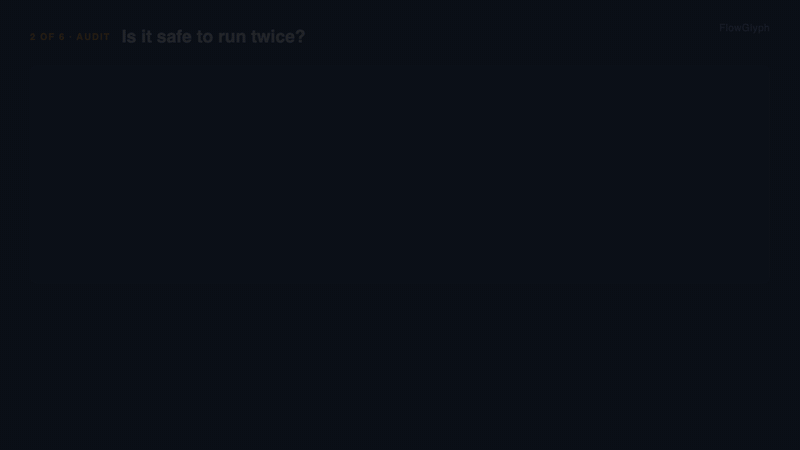

# 1. Is it safe to run twice?

**For:** RPA leads, SAP integration teams, auditors, anyone who approves a retry.
**Takes:** one command, seconds. **Needs:** `pip install "flowglyph[cli]"`.



## The situation

A robot failed halfway. An iFlow timed out. An agent wants to call an OData action again.
Someone has to answer, now, whether running it again is harmless or books the invoice twice,
and the answer is buried in XAML, iFlow XML and `$metadata` nobody opens. Platforms give hints,
UiPath has no retry flag on a workflow, OData says `POST` and nothing more, and a hint is not
an answer.

## What you do

```bash
flowglyph idempotency https://github.com/UiPath/ReFrameWork          # a repository
flowglyph idempotency ./handover --review                            # only what needs a decision
flowglyph idempotency ./handover -f csv -o functions.csv             # for a spreadsheet
flowglyph idempotency ./handover -f markdown -o FUNCTIONS.md         # for a pull request
```

## What you see

```text
 Capability                                     Kind       Effects  Idempotency  Status
 openapi/Payments_API/executePayment            operation  rWX      none         review
 openapi/Payments_API/patch_invoices_invoiceId  operation  rWdX     none         review
 uipath/Invoices/Main                           workflow   WX       none         review
 uipath/Invoices/Steps/BookInvoice              workflow   WX       none         review
 uipath/Invoices/Steps/RequestApproval          workflow   WX       none         review
5 capabilities, 5 to review.
```

`R` reads, `W` writes, `D` destroys, `X` talks to another system; upper case means yes, lower
case means it may, `pure` means none. `natural` means a repeat changes nothing more; `key` means
a repeat with the same key is a repeat; `none` means every run has an effect. The status is
the verdict: `safe`, `keyed`, `declared`, or `review`, which means it changes something and
nothing guarantees a retry is safe.

Nothing here comes from a model. A UiPath workflow inherits the effects of its activities and of
the workflows it invokes, from an editable taxonomy; an OData operation gets them from the HTTP
method and the entity set; an iFlow from its receivers. The sources settle most rows. What they
cannot settle, you do, once:

```yaml
# handover/flowglyph.overrides.yaml
capabilities:
  uipath/Invoices/Steps/BookInvoice:
    idempotency: {mode: key, key_fields: [in_Invoice]}
  uipath/Invoices/Steps/RequestApproval:
    description: Emails the finance approver; a second email is harmless.
    idempotency: {mode: natural}
```

```text
 Capability                                     Kind       Effects  Idempotency  Status
 openapi/Payments_API/executePayment            operation  rWX      none         review
 openapi/Payments_API/patch_invoices_invoiceId  operation  rWdX     none         review
 uipath/Invoices/Main                           workflow   WX       none         review
3 capabilities, 3 to review.
```

The declared rows carry `provenance: declared` in the catalog, so a reader can always tell a
fact read from the sources from a decision a person made.

## What changes

The question "can we run it again?" has a written answer per function, with its provenance,
kept next to the sources and versioned with them. The list of what still needs a decision
shrinks with every override, and `flowglyph diff old-catalog catalog --fail-on major` in CI
tells you when a change in the sources makes a contract break.

## Telling it

- **Hook:** UiPath's own ReFrameWork template has a workflow that is not safe to retry, and it
  takes one command to see which: `GetTransactionData` marks the queue item *In Progress*, so
  calling it twice takes two items.
- **Three points:** effects and retry safety are facts with a provenance, not a checkbox; the
  parser proves what it can and asks you only for the rest; one table covers UiPath, SAP, BPMN,
  n8n and APIs in the same vocabulary.
- **Demo:** `flowglyph idempotency https://github.com/UiPath/ReFrameWork`, then
  `flowglyph inspect` for the call tree, live, under a minute.
- **Where:** the UiPath Community Forum and SAP Community (each with its own sources), LinkedIn
  for RPA leads, a short post for Hacker News or dev.to on "retry safety as a static property".
