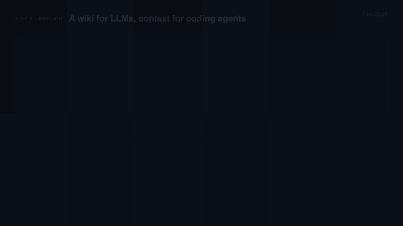

# 2. A wiki the LLM keeps

**For:** automation centres of excellence, the person who owns "the documentation".
**Takes:** two commands, then whatever time you give the LLM. **Needs:**
`pip install "flowglyph[cli]"`, any coding assistant for the maintenance.



## The situation

The documentation of the automation estate is a wiki page per robot, written at go-live and
never again. Nobody can say which robots write to the ERP, which iFlow calls which system, or
what changed last month, without opening the sources. An LLM could keep such a wiki, but
hallucinates when it writes from memory, and loses everything people added when it rewrites.

## What you do

```bash
flowglyph wiki build ./handover -o wiki
flowglyph wiki lint wiki
```

Then open the `wiki` folder in Claude Code, Codex, Cursor or any assistant and ask it to follow
`wiki/AGENTS.md`.

## What you see

```text
Wiki 30 pages in wiki
## [2026-11-07] ingest | catalog

- 18 capabilities, 3 to review
Next: flowglyph wiki lint wiki, then read wiki/AGENTS.md
```

```text
 Level    Page                                         Issue
 warning  capabilities/openapi_Payments_API_executePa  has side effects and no retry guarantee:
          yment.md                                     declare its idempotency
 info     capabilities/openapi_Payments_API_getInvoic  has no description in its source
          e.md
 warning  capabilities/uipath_Invoices_Main.md         invokes something that is not in the
                                                       sources: Steps/Missing.xaml
```

```text
wiki/
├── AGENTS.md        how an LLM maintains this wiki; yours to edit, never overwritten
├── index.md         every page by category, one line each
├── overview.md      sources, counts, what is left to review, invocations that point nowhere
├── log.md           append-only: one entry per ingest and per lint
├── capabilities/    one page per function: contract, effects, steps, used by, related
├── categories/      one page per category
├── sources/         one page per project or service, with its call trees
└── _data/           the machine-readable catalog
```

This is Andrej Karpathy's LLM Wiki pattern applied to automations: the sources are the raw
layer and are never touched; FlowGlyph writes the structural part of every page from them;
the LLM, or a person, adds what the sources cannot say. Every page ends with a **Notes**
section, and what is written there survives every rebuild. A function that leaves the sources
loses its page, unless it has notes: then the page stays, marked as removed.

## What changes

The wiki is rebuilt from the sources in seconds, so it is never older than the last commit,
and the LLM works from pages that state facts with their provenance instead of from memory.
`wiki lint` is its to-do list: functions to review, calls to things that do not exist,
workflows nothing calls, broken links.

## Telling it

- **Hook:** a wiki of your automations that is never out of date, because the facts are
  regenerated from the sources and only the notes are kept.
- **Three points:** structure from the parser, meaning from people and LLMs, both on the same
  page; notes survive every rebuild; `lint` tells the LLM what to do next.
- **Demo:** `wiki build` on a public repository, open it in a coding assistant, ask "which
  workflows write to a queue and are not safe to retry?" and watch it answer from the pages.
- **Where:** a post for the LLM-wiki crowd (Hacker News, X, the Karpathy gist's audience) and a
  CoE-facing version on LinkedIn.
